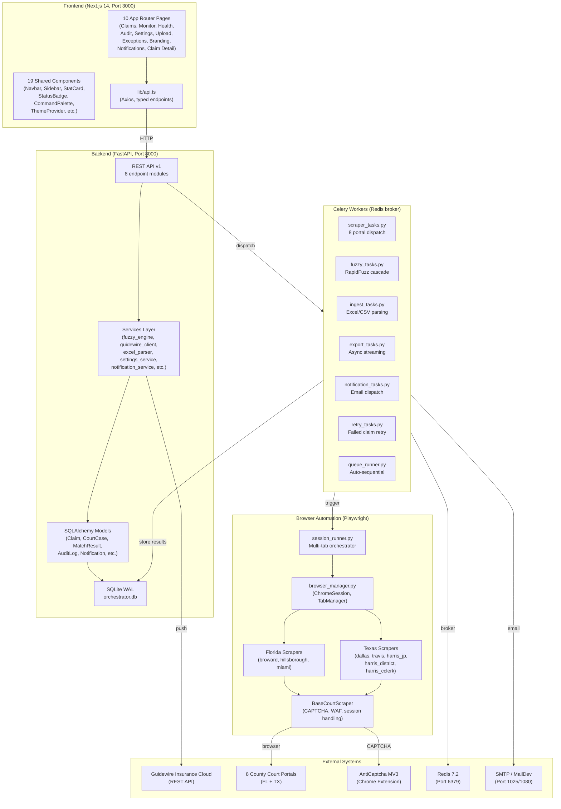
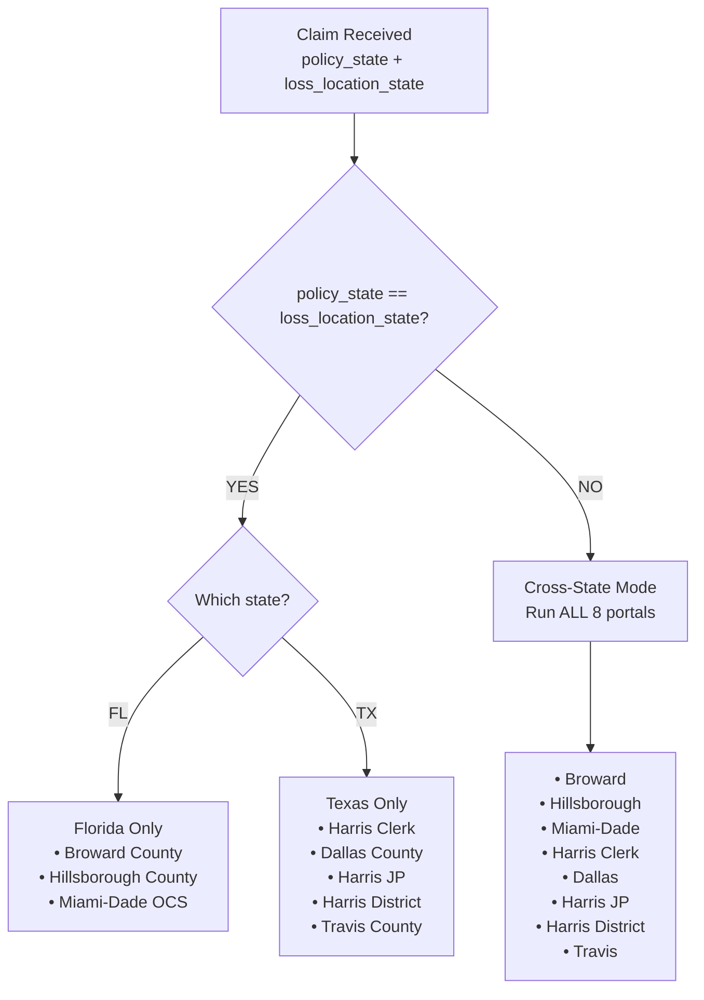
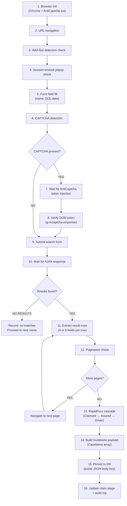
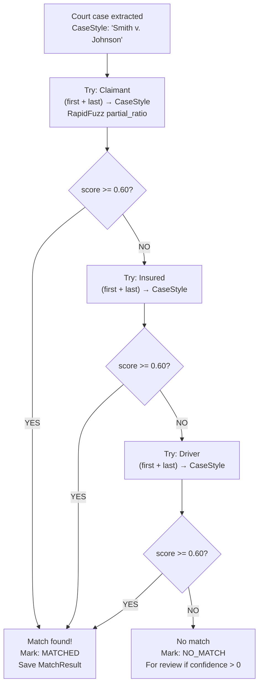

# UAIC Architecture Context

> **Purpose:** Pure architectural reference — no governance prose. For AI agents and developers who need structural understanding fast.
> **Last Updated:** 2026-11-03 (`IMP-2026-1103-002`)

---

## 1. High-Level Component Diagram



---

## 2. State Routing Decision Tree



---

## 3. Scraper Lifecycle (37-Step)



---

## 4. Fuzzy Match Cascade



---

## 5. Celery Queue Topology

| Queue | Workers | Tasks |
|---|---|---|
| `default` | 10 threads | `scraper_tasks`, `fuzzy_tasks`, `ingest_tasks`, `export_tasks` |
| `notifications` | 2 threads | `notification_tasks` |
| `retries` | 2 threads | `retry_tasks` |
| Broker | Redis 7.2 (Port 6379) | All queues |
| Monitor | Flower (Port 5555) | Real-time task visibility |

**Task execution order for a single claim:**
```
ingest_tasks.parse_file
    → scraper_tasks.run_portal_scraper (×1 to ×8 portals)
        → fuzzy_tasks.run_fuzzy_match
            → fuzzy_tasks.push_to_guidewire
                → notification_tasks.send_completion_alert
```

---

## 6. Database Schema Overview

| Table | Key Columns | Purpose |
|---|---|---|
| `claims` | id, claim_number, policy_state, loss_location_state, claimant_*, insured_*, driver_*, dol, stage, status | Core claim records |
| `court_cases` | id, claim_id, portal_key, case_number, case_style, filing_date, case_status, case_type | Extracted court case data |
| `match_results` | id, claim_id, court_case_id, match_type, score, is_confirmed | Fuzzy match outcomes |
| `audit_logs` | id, claim_id, event_type, message, created_at | Immutable audit trail |
| `error_screenshots` | id, claim_id, portal_key, screenshot_path, error_message | Browser error captures |
| `notifications` | id, event_type, recipient, subject, status, sent_at | Email delivery history |
| `system_settings` | key, value | DB-persisted configuration |
| `guidewire_submissions` | id, claim_id, payload, response, status | Guidewire push history |

---

## 7. Portal Output Schema Matrix

| Portal | CaseNumber | CaseStyle | FilingDate | CaseStatus | CaseType |
|---|---|---|---|---|---|
| Broward County | ✅ | ✅ | ✅ | ✅ | ✅ |
| Hillsborough County | ✅ | ✅ | ✅ | ✅ | ✅ |
| Miami-Dade OCS | ✅ | ✅ | ✅ | ✅ | ✅ |
| Dallas County | ✅ | ✅ | ✅ | ✅ | ✅ |
| Travis County | ✅ | ✅ | ✅ | ✅ | ✅ |
| Harris District | ✅ | ✅ | ✅ | ✅ | ✅ |
| Harris JP | ✅ | ✅ | ✅ | ✅ | ❌ **NO CaseType** |
| Harris County Clerk | ✅ | ✅ | ✅ | ✅ | ❌ **NO CaseType** |

> [!CAUTION]
> **NEVER add CaseType to Harris JP or Harris County Clerk.** This is a non-negotiable business rule matching Power Automate V4 Robin flows.

---

## 8. CAPTCHA Handling by Portal

| Portal | CAPTCHA Type | Cooldown | Recovery |
|---|---|---|---|
| Broward County | Google reCAPTCHA v2 + Turnstile | 120s token expiry | Auto re-solve |
| Miami-Dade OCS | reCAPTCHA v3 badge + challenge | Session-based | AntiCaptcha extension |
| Travis County | reCAPTCHA v2 Smart Search | 600s WAF cooldown | Auto re-dispatch |
| Dallas County | Cloudflare Turnstile | Token renegotiation | `CaptchaResolutionError` → `AWAITING_HUMAN` |
| Hillsborough | PerimeterX (no traditional CAPTCHA) | 300s bot check cooldown | HumanInteractionEngine |
| Harris JP | None | — | — |
| Harris Clerk | None | — | — |
| Harris District | None | — | — |

---

## 9. Key File Locations

| Purpose | File |
|---|---|
| FastAPI app entry | `backend/app/main.py` |
| Config / env | `backend/app/core/config.py` |
| DB session | `backend/app/core/database.py` |
| Celery app | `backend/app/core/celery_app.py` |
| Base scraper | `backend/app/automation/base.py` |
| Session runner | `backend/app/automation/session_runner.py` |
| Fuzzy engine | `backend/app/services/fuzzy_engine.py` |
| Guidewire client | `backend/app/services/guidewire_client.py` |
| Settings service | `backend/app/services/settings_service.py` |
| Excel parser | `backend/app/services/excel_parser.py` |
| Error classifier | `backend/app/services/error_classifier.py` |
| Human engine | `backend/app/automation/human_engine.py` |
| API router | `backend/app/api/v1/api.py` |
| Test conftest | `backend/tests/conftest.py` |
| Frontend entry | `frontend/src/app/layout.tsx` |
| API client | `frontend/src/lib/api.ts` |
| TypeScript types | `frontend/src/types/index.ts` |
| Theme tokens | `frontend/src/app/globals.css` |
| Theme provider | `frontend/src/components/ThemeProvider.tsx` |
| Branding page | `frontend/src/app/branding/page.tsx` |

