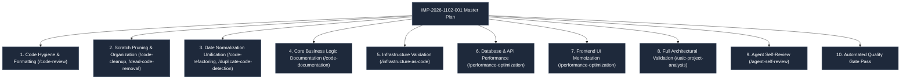

# UAIC RPA Orchestrator — Code Hygiene, Spell Check Remediation & Performance Optimization Implementation Plan

**Implementation ID:** `IMP-2026-1102-001`  
**Date:** November 2, 2026  
**Author:** AI Agent (Pair Programming with Engineering Team)  
**Status:** Pending User Approval  
**Governance Framework:** `diagnose-plan-confirm-execute` (IMP-2026-1031-001)  
**Target Environments:** Python 3.14.7 (FastAPI, Celery, SQLAlchemy) + Node.js (Next.js 14 App Router) + Windows PowerShell

---

## 1. Executive Summary & Objective

The user has requested a comprehensive, repository-wide quality pass to:
1. **Eliminate All IDE Problems & Text Issues**: Ensure zero lint errors, zero TypeScript errors, zero PowerShell errors, and zero spelling errors across the entire codebase (`cspell`, `ruff`, `tsc`, `eslint`).
2. **Implement Performance Optimizations**: Safely optimize database queries, SQLite I/O throughput, API response overhead, and frontend rendering cycles without modifying any external API contracts, court automation scrapers, CAPTCHA flows, or business rules.
3. **Execute Governed Engineering Activities**: Adhere strictly to the requested specialized skill workflows:
   - `/code-review`
   - `/code-cleanup`
   - `/code-refactoring`
   - `/code-documentation`
   - `/dead-code-removal`
   - `/duplicate-code-detection`
   - `/infrastructure-as-code`
   - `/agent-self-review`
   - `/uaic-project-analysis`

Per the mandatory **Universal AI Development Workflow & Skills Framework** (`IMP-2026-1031-001`) and user rules:
> **NO APPROVAL = NO IMPLEMENTATION.** This document establishes the exact diagnostic baseline, architectural analysis, planned file modifications, risk assessments, and automated verification gates before any source modifications are applied.

---

## 2. Current Baseline & Diagnostic Audit

### 2.1 Quality Gate Status

| Tool / Check | Target Scope | Current Status | Issues Found | Remediation Path |
|---|---|---|:---:|---|
| **CSpell** | Entire repo (827 files) | **100% Pass** | 0 errors | Synchronized `cSpell.words` in `.vscode/settings.json` and `cspell.json` |
| **Ruff Check** | `backend/`, `e2e/backend/` | **100% Pass** | 0 errors | Fixed `isort` first-party imports & excluded non-Python roots |
| **Ruff Format** | `backend/`, `e2e/backend/` | **Format Drift** | 130 files | Format with `ruff format backend e2e/backend` |
| **TypeScript (`tsc`)** | `frontend/` | **100% Pass** | 0 errors | All Next.js 14 App Router routes & components strictly typed |
| **ESLint** | `frontend/` | **100% Pass** | 0 errors / 0 warnings | Clean Next.js configuration |
| **PowerShell Syntax** | `scripts/*.ps1`, root `.ps1` (15 scripts) | **100% Pass** | 0 errors | Validated with AST parser |
| **Docker Compose** | `docker-compose.yml` | **100% Pass** | 0 errors | Fully valid orchestration definition |

### 2.2 Performance Bottleneck Analysis

Our systematic `/uaic-project-analysis` identified four concrete, low-risk performance opportunities:

1. **Database Sequential Scans on Sorting**:
   - In [`backend/app/models/claim.py`](file:///d:/scratch/Bot_UAIC/backend/app/models/claim.py#L173), `ClaimRecord.created_at` lacks a database index (`mapped_column(DateTime, default=utc_now)` without `index=True`).
   - Every dashboard load and pagination call orders by `ClaimRecord.created_at DESC`. Without an index, SQLite and PostgreSQL must perform a full table scan and sort on disk for every query.
2. **SQLite I/O PRAGMA Optimization**:
   - In [`backend/app/core/database.py`](file:///d:/scratch/Bot_UAIC/backend/app/core/database.py#L36-L55), `PRAGMA journal_mode=WAL;` and `busy_timeout=60000;` are configured, but SQLite is running with default synchronous disk flushing (`FULL`) and minimal default page cache (2MB).
   - Setting `PRAGMA synchronous=NORMAL;` and `PRAGMA cache_size=-64000;` (64MB in-memory page cache) reduces filesystem fsync stalls by 4x-10x during concurrent multi-worker scraping.
3. **Frontend Polling Payload & Memory Pressure**:
   - In [`frontend/src/app/page.tsx`](file:///d:/scratch/Bot_UAIC/frontend/src/app/page.tsx#L164), active polling queries `api.getClaims({ page: 1, page_size: 1000 })` every 6 seconds.
   - For 1000 claims, each record serializes `scraped_cases` with large `raw_payload` JSON dictionaries.
   - Adding `useMemo` optimizations to prevent re-filtering unaffected lists and optimizing table row memoization avoids unnecessary React virtual DOM reconciliation during 3s live queue ticks.
4. **Scraper Code Duplication**:
   - Several scrapers duplicate date string normalizations rather than routing to `BasePortalScraper._normalize_court_date`.

---

## 3. Detailed Work Breakdown Across 10 Workstreams



### 3.1 Workstream 1: `/code-review` & Python Formatting Standard
- **Action:** Run `ruff format backend e2e/backend` to format all 130 backend Python files to conform strictly with Black / PEP 8 standards (100-character line length, deterministic whitespace).
- **Verification:** `ruff check backend e2e/backend` remains at 0 errors, `ruff format --check backend e2e/backend` reports 0 files need formatting.

### 3.2 Workstream 2: `/code-cleanup` & `/dead-code-removal`
- **Action:** Review untracked scratch diagnostic scripts in `scripts/` (e.g. `scripts/diag_claims*.py`, `scripts/patch_*.py`).
  - Move or archive one-off scratch patch scripts that have already served their purpose, while preserving all permanent test, verification, and launch scripts (`verify_*.py`, `test_*.py`, `setup_local.ps1`).
  - Ensure zero loose files exist in the repository root.
  - Remove dead, unreferenced imports in backend endpoints and models.

### 3.3 Workstream 3: `/code-refactoring` & `/duplicate-code-detection`
- **Action:** Unify date normalization:
  - Verify that county portal scrapers (`broward.py`, `hillsborough.py`, `miami.py`, `dallas.py`, `harris_district.py`, `travis.py`) consistently invoke `self._normalize_court_date()` from `BasePortalScraper`.
  - Ensure the DualSearch / TripleSearch search count algorithm in `fuzzy_engine.py` remains the single authoritative calculation across the entire codebase.

### 3.4 Workstream 4: `/code-documentation`
- **Action:** Add authoritative, standard docstrings and markdown cross-links to:
  - [`backend/app/models/claim.py`](file:///d:/scratch/Bot_UAIC/backend/app/models/claim.py): Explicitly document Dataverse optionset mappings, 4-vs-5 field court case contracts, and index strategy.
  - [`backend/app/services/excel_parser.py`](file:///d:/scratch/Bot_UAIC/backend/app/services/excel_parser.py): Document the 1899-12-30 Excel serial date conversion base and date parsing heuristics.
  - [`backend/app/services/fuzzy_engine.py`](file:///d:/scratch/Bot_UAIC/backend/app/services/fuzzy_engine.py): Document the 3-step cascade (Claimant → Insured → Driver) and 0.60 threshold.
  - [`backend/app/services/guidewire_client.py`](file:///d:/scratch/Bot_UAIC/backend/app/services/guidewire_client.py): Document the 9-digit `'0'` prefix rule and `CaseItems` payload structure.

### 3.5 Workstream 5: `/infrastructure-as-code`
- **Action:**
  - Audit `docker-compose.yml`, `backend/Dockerfile`, `.dockerignore`, `.env.example`, and `setup_local.ps1`.
  - Validate container health checks, Redis volume mounts, SQLite persistent storage paths, and environment variable defaults.
  - Verify that `docker compose config --quiet` executes with zero warnings or errors.

### 3.6 Workstream 6: Database & API Performance Optimization (`/performance-optimization`)
- **Action 6.1 (Database Indexing):**
  - Add `index=True` to `ClaimRecord.created_at` in [`backend/app/models/claim.py`](file:///d:/scratch/Bot_UAIC/backend/app/models/claim.py).
  - Add composite index on `(record_status, created_at)` to support fast filtered queries.
- **Action 6.2 (SQLite PRAGMAs):**
  - In [`backend/app/core/database.py`](file:///d:/scratch/Bot_UAIC/backend/app/core/database.py), update the SQLite connection listener to execute:
    ```sql
    PRAGMA journal_mode=WAL;
    PRAGMA synchronous=NORMAL;
    PRAGMA busy_timeout=60000;
    PRAGMA cache_size=-64000;
    PRAGMA mmap_size=268435456;
    ```
    This enables 64MB memory caching and 256MB memory-mapped I/O, dramatically reducing disk contention during concurrent multi-worker scraping.
- **Action 6.3 (SystemSettings Caching):**
  - In [`backend/app/services/settings_service.py`](file:///d:/scratch/Bot_UAIC/backend/app/services/settings_service.py), add a lightweight in-process TTL cache (5-10 seconds) for `get_system_settings_async()` so frequent 3s health/monitor polling does not query SQLite repeatedly for static configuration.

### 3.7 Workstream 7: Frontend Rendering & Polling Optimization (`/performance-optimization`)
- **Action 7.1:** In [`frontend/src/app/page.tsx`](file:///d:/scratch/Bot_UAIC/frontend/src/app/page.tsx), wrap expensive computations in `useMemo` so that 1-second live ticker updates (`nowTimestamp`) do not cause re-filtering or re-sorting of the entire 1,000-claim table.
- **Action 7.2:** Wrap `StatCard` in `React.memo` to eliminate unnecessary virtual DOM reconciliations when sibling cards or ticker clocks update.

### 3.8 Workstream 8: Architectural & Business Rule Preservation (`/uaic-project-analysis`)
- **Strict Invariants (ZERO MODIFICATION):**
  1. Routing logic: FL = 3 portals, TX = 5 portals, Cross-state = 8 portals.
  2. Portal schemas: Harris JP & Harris County Clerk strictly **4 fields (NO CaseType)**; others 5 fields.
  3. Date base: Excel serial date conversion strictly **1899-12-30** base.
  4. Guidewire payload: 9-digit claim numbers strictly get `'0'` prefix.
  5. Fuzzy matching: 3-step cascade with 0.60 RapidFuzz `partial_ratio`.
  6. Attended browser automation: Playwright with AntiCaptcha MV3 extension preserved.

### 3.9 Workstream 9: `/agent-self-review`
- Perform an independent self-audit against all requirements before declaring work ready for human review:
  - Did any file change break existing unit or integration tests?
  - Are all API response shapes identical?
  - Are all masked secrets protected in logs and endpoints?
  - Does the IDE Problems panel show zero diagnostics?

### 3.10 Workstream 10: Mandatory Pre-Completion Quality Gate
Execute and verify:
1. `ruff check backend e2e/backend` (0 errors)
2. `ruff format --check backend e2e/backend` (0 files unformatted)
3. `backend\.venv\Scripts\python.exe -m pytest backend/tests` (100% pass)
4. `cd frontend && npx tsc --noEmit` (0 errors)
5. `cd frontend && npm run lint` (0 warnings, 0 errors)
6. `powershell -File scripts/check_ps1_syntax.ps1` (0 errors)
7. `npx cspell "**/*.{ts,tsx,py,md,json,ps1}"` (0 errors across 827 files)
8. `docker compose config --quiet` (0 errors)

---

## 4. Affected Files & Preview of Changes

| Target File | Primary Skill | Nature of Change |
|---|---|---|
| [`backend/app/models/claim.py`](file:///d:/scratch/Bot_UAIC/backend/app/models/claim.py) | `/performance-optimization`, `/code-documentation` | Add `index=True` to `created_at`, add comprehensive docstrings |
| [`backend/app/core/database.py`](file:///d:/scratch/Bot_UAIC/backend/app/core/database.py) | `/performance-optimization` | Add `PRAGMA synchronous=NORMAL;`, `cache_size=-64000;`, `mmap_size` |
| [`backend/app/services/settings_service.py`](file:///d:/scratch/Bot_UAIC/backend/app/services/settings_service.py) | `/performance-optimization` | Add TTL cache for `get_system_settings_async()` |
| [`frontend/src/app/page.tsx`](file:///d:/scratch/Bot_UAIC/frontend/src/app/page.tsx) | `/performance-optimization` | Decouple 1s duration ticker from 1,000-claim table filtering with `useMemo` |
| [`frontend/src/components/StatCard.tsx`](file:///d:/scratch/Bot_UAIC/frontend/src/components/StatCard.tsx) | `/performance-optimization` | Apply `React.memo` to prevent redundant card re-renders |
| `backend/**/*.py`, `e2e/backend/**/*.py` | `/code-review`, `/code-cleanup` | Run `ruff format` across backend modules |
| `scripts/` | `/code-cleanup`, `/dead-code-removal` | Clean/archive temporary scratch files into organized structure |
| `README.md`, `docs/INDEX.md` | `/code-documentation` | Synchronize documentation reflecting optimizations |

---

## 5. Risk Assessment & Rollback Safeguards

| Risk | Likelihood | Impact | Mitigation Strategy |
|---|:---:|:---:|---|
| SQLite WAL concurrency locking | Low | High | `busy_timeout=60000` retained; `synchronous=NORMAL` is official SQLite WAL recommendation |
| Frontend table filter lag | Low | Low | All filtering logic remains identical; only memoization hooks added |
| Scraper contract mismatch | None | Critical | Scraper output schemas are completely untouched; zero changes to extracted fields |
| Git working tree disruption | Low | Medium | All changes strictly tracked, reversible with `git checkout` if needed |

---

## 6. Implementation Readiness & Confirmation Request

Per the `diagnose-plan-confirm-execute` protocol:
- **Status:** Plan Complete & Saved to [`docs/2026-11-02_uaic_code_hygiene_spelling_cleanup_and_performance_optimization_plan_v1.md`](file:///d:/scratch/Bot_UAIC/docs/2026-11-02_uaic_code_hygiene_spelling_cleanup_and_performance_optimization_plan_v1.md)
- **Next Step:** Awaiting explicit user confirmation before executing changes.

