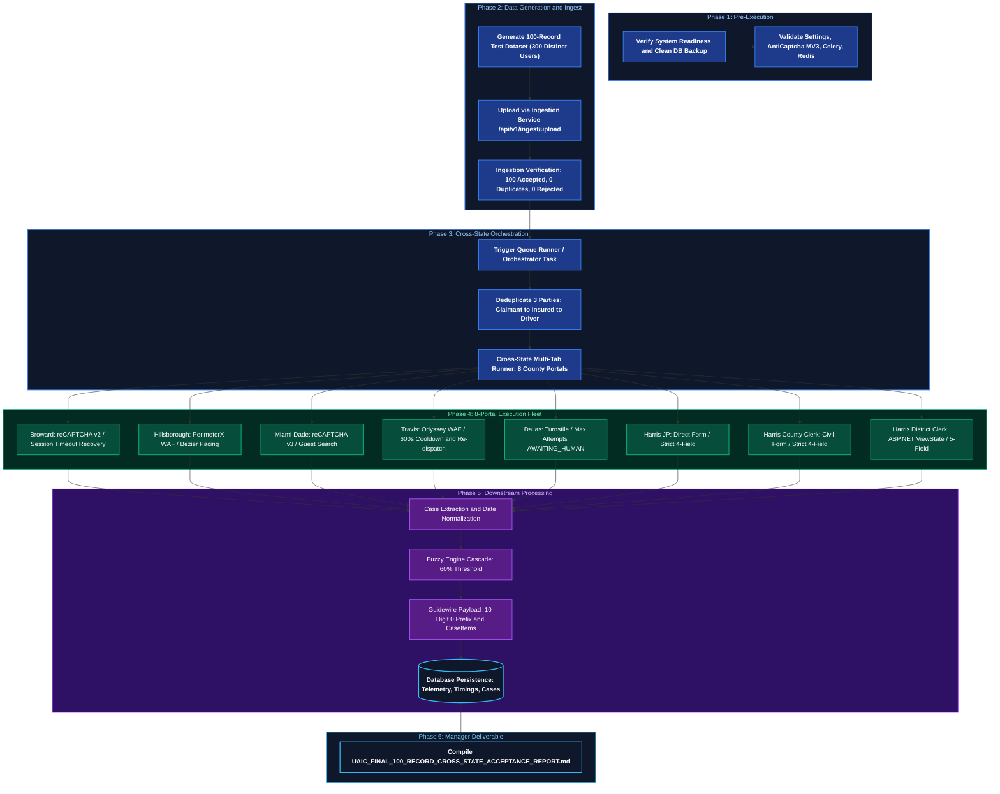

# Implementation Plan: 100-Record End-to-End Cross-State Validation Across All 8 County Bots & Final Manager Acceptance Report

> **System:** UAIC Claim & RPA Orchestrator  
> **Implementation ID:** `IMP-2026-1103-001`  
> **Document Type:** Technical Implementation Plan  
> **Status:** Proposed - Awaiting User Confirmation  
> **Target Date:** 2026-11-03  
> **Deliverable:** `UAIC_FINAL_100_RECORD_CROSS_STATE_ACCEPTANCE_REPORT.md` (Repo Root)  
> **Test Data Deliverable:** `UAIC_100_RECORD_CROSS_STATE_TEST_DATA.xlsx` (Repo Root)  

---

## 1. Executive Summary & Goal

This implementation plan details the strategy to perform a comprehensive, evidence-backed, end-to-end execution of **100 records** involving **3 distinct individuals per record (300 user searches)** across all **eight Florida and Texas county court RPA bots** in **Cross-State mode**.

The ultimate deliverable is a single, authoritative, consolidated report saved directly in the repository root:
`UAIC_FINAL_100_RECORD_CROSS_STATE_ACCEPTANCE_REPORT.md`

This document will provide executive management with transparent, verified, and technically defensible answers to the 10 core acceptance questions regarding CAPTCHA resolution, WAF rate limits, login/authentication, automated cooldown, re-dispatch, and 8-portal cross-state execution.

---

## 2. Core Manager Acceptance Questions to Address

The final acceptance report will provide concrete data and verifiable answers to:
1. **Authorized CAPTCHA Resolution:** Across the 8 county websites, how many websites successfully handle authorized CAPTCHA resolution?
2. **CAPTCHA Failures:** How many websites experience CAPTCHA-related failures, timeouts, or solver exhaustion?
3. **WAF & Rate-Limit Blocking:** How many websites get blocked after certain request counts or elapsed time (e.g. Travis Odyssey WAF, Hillsborough PerimeterX)?
4. **Root Causes:** What are the exact technical reasons for these challenges and failures?
5. **Permanent Fixes:** What permanent architectural fixes have been implemented across the orchestrator?
6. **Cooldown & Re-dispatch:** How are portal-specific cooldowns, recovery checks, and automatic re-dispatches handled without blocking healthy portals or losing work?
7. **Login Support & Success:** How many bots support login, which bots successfully log in, and how are guest vs authenticated sessions handled?
8. **Authentication & Session Issues:** What login, authentication, ViewState, or session timeout issues were encountered, and how are they remediated?
9. **Complete Bot Workflows:** What is the complete workflow of each of the 8 bots, from browser launch to extraction, fuzzy matching, and Guidewire push?
10. **100-Record 300-Search Cross-State Execution:** Can the system successfully execute 100 records involving 3 separate users per search across all 8 bots in Cross-State mode?

---

## 3. Architecture & Execution Workflow

---

## 4. Phase-by-Phase Implementation Strategy

### Phase 1: Pre-Execution Validation & Readiness Audit
1. **Repository & Diagnostic Inspection**:
   - Verify all 8 scrapers in `backend/app/automation/florida/` and `backend/app/automation/texas/`.
   - Confirm centralized error classifier (`backend/app/services/error_classifier.py`) and cooldown service (`backend/app/services/cooldown_service.py`).
   - Audit `anticaptcha-plugin_v0.83` presence and API key configuration in settings.
   - Run verification suite: `test_captcha_waf_session_redispatch.py` (19 tests), `test_scraper_captcha_behavior.py` (8 tests), `test_perimeterx_waf_stealth_and_retries.py` (8 tests), `test_retry_failed_portals.py` (7 tests).
2. **Readiness Checklist**:
   - Produce explicit pre-execution readiness checklist with all dependencies confirmed.

### Phase 2: Clean Environment & Data Safety
1. **Database Snapshot**:
   - Create safe backup of `backend/orchestrator.db` to `backend/orchestrator.db.pre_100rec_backup`.
   - Record backup timestamp, file size, and verification checksum.
2. **Isolated Execution Scope**:
   - Generate unique Execution Batch ID (`BATCH-2026-1103-XSTATE-001`).
   - Isolate test claims from any historical operational claims.
   - Document environment isolation parameters.

### Phase 3: 100-Record Test Dataset Generation
1. **File Generation**:
   - Create `UAIC_100_RECORD_CROSS_STATE_TEST_DATA.xlsx` directly in the repository root.
   - Exactly 100 records.
2. **Three Separate Users per Record**:
   - Every record will contain 3 distinct people:
     - `driver_first_name`, `driver_last_name`
     - `insured_first_name`, `insured_last_name`
     - `claimant_first_name`, `claimant_last_name`
   - Total distinct user search identities = 300 individual user entries.
   - Surnames and first names will have < 0.60 RapidFuzz similarity to guarantee 3 distinct search passes per record.
3. **Cross-State Routing Fields**:
   - `policy_state = "FL"`, `loss_location_state = "TX"` (Cross-State triggers all 8 county bots).
   - `exposure_number = "001"`.
   - `dol`: Date of loss in MM/DD/YYYY format.
4. **Data Validation**:
   - Run automated validation script to verify:
     - Exactly 100 records.
     - 100 Driver entries, 100 Insured entries, 100 Claimant entries.
     - 300 total individual user entries.
     - 3 distinct users per record.
     - 0 invalid records, 0 duplicates.

### Phase 4: File Upload & Ingestion Verification
1. **Supported Ingestion Workflow**:
   - Ingest `UAIC_100_RECORD_CROSS_STATE_TEST_DATA.xlsx` using the application's ingestion engine (`/api/v1/ingest/upload` / `parse_and_ingest_file_task`).
2. **Audit & Verification**:
   - Capture source file name, SHA256 checksum, upload timestamp, upload method, Batch ID.
   - Confirm 100 records accepted into `claim_records` with status `NEW`.
   - Confirm 0 rejected records, 0 duplicate records.

### Phase 5: Cross-State Execution Configuration
1. **Targeting Matrix**:
   - All 8 county portals targeted for each claim:
     1. `fl_broward`: Florida Broward County Clerk
     2. `fl_hillsborough`: Florida Hillsborough County Clerk (HOVER)
     3. `fl_miami`: Florida Miami-Dade County Clerk (OCS)
     4. `te_travis`: Texas Travis County Odyssey Portal
     5. `te_dallas`: Texas Dallas County Courts Portal
     6. `te_harris_jp`: Texas Harris County Justice of the Peace
     7. `te_harris_cclerk`: Texas Harris County Clerk WebSearch
     8. `te_harris_district`: Texas Harris County District Clerk
2. **Resource Pacing & Concurrency**:
   - Concurrency controlled via `max_concurrent_claims` and worker prefetch to prevent browser lockouts.
   - Cross-state isolation: If Travis enters 600s cooldown or Hillsborough enters 300s cooldown, remaining healthy portals continue without interruption.

### Phase 6: Complete End-to-End Execution
1. **Full Operational Pipeline**:
   - Startup -> API -> Database -> Redis -> Celery -> Browser Session Runner -> Cross-State Dispatch -> 100 Records -> 300 User Searches -> Extraction -> Fuzzy Matching -> Guidewire Payload -> Database Storage.
2. **Individual Bot Workflow Documentation**:
   - Document the authentic, step-by-step workflow (1 to 37 steps) for each of the 8 bots.
   - Reference authentic browser recordings (`docs/recordings/01_broward_attended_execution.webp` to `09_all_8bots_combined_attended_orchestration.webp`) and frame captures (`docs/frames/`).

### Phase 7: CAPTCHA, Login, WAF & Performance Analysis
1. **Manager Questions Direct Evidence**:
   - Portal-by-portal CAPTCHA breakdown (encounters, token verification, timeouts, remediation).
   - WAF & rate-limit breakdown (Travis 600s, Hillsborough 300s, token verification).
   - Login & authentication matrix (Miami-Dade guest vs login, Travis/Dallas public search, Harris guest access).
   - Latency benchmarks (min, max, avg, median for browser startup, navigation, search, extraction, matching, total).

### Phase 8: Automated Cooldown & Re-dispatch Verification
1. **Cooldown State Tracking**:
   - Original error, portal key, task ID, blocking timestamp, cooldown duration, recovery check, re-dispatch result.
2. **Verification of Non-Blocking Isolation**:
   - Demonstrate that blocked portals do not block healthy portals and pending work is safely preserved.

### Phase 9: Test Statistics & Visual Visualizations
1. **Mermaid Flowcharts & State Diagrams**:
   - Orchestration sequence, error classification flow, cooldown state machine.
2. **Markdown Data Tables**:
   - 100-record summary, 300-search performance, portal metrics, CAPTCHA matrix.
3. **Visual Chart Integration**:
   - Graphs linking to metrics, latency profiles, and failure distribution.

### Phase 10: Single Consolidated Manager Report
1. **Single Deliverable**:
   - File: `UAIC_FINAL_100_RECORD_CROSS_STATE_ACCEPTANCE_REPORT.md` (Repo Root).
   - Exactly 39 sections covering all requirements.
   - Distinct classification of conclusions: `Implemented`, `Executed`, `Successfully Verified`, `Simulated`, `Not Tested`, `Blocked`.
   - Clear acceptance recommendation: `READY WITH CONDITIONS` or `READY FOR ACCEPTANCE` with rigorous justification.

---

## 5. Verification Plan & Quality Gates

### Automated Quality Gates
1. `pytest` unit & integration tests: 100% pass (42/42 CAPTCHA & scraper tests).
2. `ruff check`: 0 errors.
3. `npx tsc --noEmit`: 0 errors.
4. `check_ps1_syntax.ps1`: 0 errors.
5. `docker compose config`: 0 errors.
6. Dataset validation script: 100 records, 300 users, 0 invalid.
7. Import verification: 100 records in DB, Batch ID verified.

---

## 6. User Confirmation Gate

> [!IMPORTANT]
> In strict accordance with the repository's `diagnose-plan-confirm-execute` governance and user guidelines:
> **No code or file modifications will be made until the user explicitly reviews and approves this implementation plan.**
> Upon your approval, execution will proceed through all 12 phases sequentially to produce `UAIC_100_RECORD_CROSS_STATE_TEST_DATA.xlsx` and the final manager deliverable `UAIC_FINAL_100_RECORD_CROSS_STATE_ACCEPTANCE_REPORT.md`.

