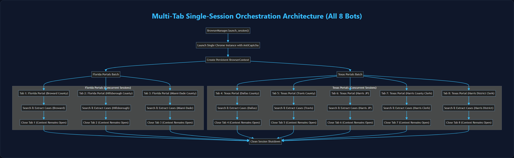

# UAIC All 8 Bots Attended Execution Step-by-Step Operator Manual (v1)

> **Document Type:** Operational Runbook & Execution Manual  
> **Document Identifier:** `uaic_all_8bots_attended_execution_step_by_step_manual_v1`  
> **Target Audience:** System Operators, Claims Adjusters, QA Automation Engineers  
> **Environment:** Windows 10/11 Local (`setup_local.ps1`) & Containerized Docker (`http://localhost:6080/vnc.html`)  
> **Implementation ID:** `IMP-2026-1031-002`  

---

## 1. System Overview & Attended Execution Model

The **UAIC RPA Orchestrator** automates court legal case discovery across 8 county court portals spanning Florida and Texas. 

**Attended (Visible GUI) Mode** runs a visible Google Chrome browser window on the operator desktop (or inside an Xvfb virtual display streamed via noVNC in Docker). It enables operators to:
1. Visually monitor legal searches across multiple county portals in real time.
2. Confirm automated solving of Google reCAPTCHA v2/v3, Cloudflare Turnstile, and Image CAPTCHAs via the Anti-Captcha MV3 extension.
3. Provide manual human intervention if a portal presents unexpected two-factor verification or terms-of-service popups.

---

## 2. Pre-Execution Setup & Verification Checklist

Before initiating an attended 8-bot run:

- [ ] **Python Runtime**: Verify Python 3.14.7 virtual environment (`backend/.venv`).
- [ ] **Google Chrome**: Ensure Google Chrome is installed at `%ProgramFiles%\Google\Chrome\Application\chrome.exe`.
- [ ] **AntiCaptcha Extension**: Verify `anticaptcha-plugin_v0.83/` exists in repository root.
- [ ] **Services Online**: Ensure FastAPI backend (`:8000`), Next.js frontend (`:3000`), and Redis (`:6379`) are running.

### Setting Attended Mode via Settings Page
1. Navigate to **Robot Settings** at `http://localhost:3000/settings`.
2. Locate the **Execution Mode** card.
3. Select **Attended (Visible GUI)**.
4. Verify the **Headless Mode** toggle switches to `OFF`. Click **Save Changes**.

---

## 3. Step-by-Step Execution Workflow Across All 8 Bots



> [!TIP]
> **Interactive High-Resolution Flowchart Viewer**: Open [`SYSTEM_ARCHITECTURE_AND_FLOWCHARTS_VIEWER.html`](SYSTEM_ARCHITECTURE_AND_FLOWCHARTS_VIEWER.html) in your browser to inspect, zoom, and navigate all 12 platform architectural diagrams with animated status counters.

```mermaid
flowchart TD
    classDef default fill:#1e293b,stroke:#475569,stroke-width:1.5px,color:#f8fafc;
    Start["Initiate 8-Bot Attended Automation"] --> Launch["Launch Google Chrome Instance with AntiCaptcha MV3"]
    Launch --> Pool["Managed Tab Concurrency Pool (Max 4 Active Tabs)"]

    subgraph Wave1 ["Wave 1: Active Tabs"]
        T1["Tab 1: Broward County Clerk (FL)"]
        T2["Tab 2: Hillsborough County - HOVER (FL)"]
        T3["Tab 3: Miami-Dade County - OCS (FL)"]
        T4["Tab 4: Dallas County Courts (TX)"]
    end

    subgraph Wave2 ["Wave 2: Queued Tabs"]
        T5["Tab 5: Travis County Odyssey (TX)"]
        T6["Tab 6: Harris County JP (TX)"]
        T7["Tab 7: Harris County Clerk (TX)"]
        T8["Tab 8: Harris County District Clerk (TX)"]
    end

    Pool --> Wave1
    Wave1 -->|Tab Completes Searches & Closes| Wave2
    Wave2 --> Aggregate["Aggregate 8 JSON Datasets"]
    Aggregate --> Deduplicate["RapidFuzz 3-Tier Cascade Matching"]
    Deduplicate --> Guidewire["Submit Payload to Guidewire Insurance Cloud"]


    style Wave1 fill:#0f172a,stroke:#3b82f6,stroke-width:1.5px,color:#93c5fd
    style Wave2 fill:#022c22,stroke:#10b981,stroke-width:1.5px,color:#6ee7b7```

### 3.1 Step 1: Ingest Claim Records
- Navigate to `/upload`.
- Upload `e2e/fixtures/ProdRecords8Bots.xlsx` containing cross-state claim data (e.g. Policy State: `FL`, Loss Location: `TX`).
- Click **Import Claims**. The claim appears in status `PENDING`.

### 3.2 Step 2: Trigger Orchestration
- Click **Start Automation** on the claim card or use the API:
  ```bash
  curl -X POST http://localhost:8000/api/v1/claims/{claim_id}/start
  ```
- Because Policy State (`FL`) does not equal Loss State (`TX`), the router activates **all 8 court portals**.

### 3.3 Step 3: Portal-by-Portal Execution Progression

| Portal | County | State | Scraper Tab Actions | CAPTCHA / Challenges |
|---|---|---|---|---|
| **Broward** | Broward County Clerk | FL | Searches Claimant, Insured, Driver on Angular case portal | reCAPTCHA v2 solved in ~14s |
| **Hillsborough** | Hillsborough HOVER | FL | Navigates `#nav-Party-tab`, disambiguates party types | Direct table search |
| **Miami-Dade** | Miami-Dade OCS | FL | Enters party names, dispatches DOM input events | reCAPTCHA v3 invisible token injected |
| **Dallas** | Dallas County Courts | TX | Smart Search party selection, date filters `>= 2010-01-01` | Cloudflare Turnstile token injected |
| **Travis** | Travis County Odyssey | TX | Smart Search party selection, downloads civil records | reCAPTCHA v2 solved |
| **Harris JP** | Harris County JP | TX | Precinct civil filing search (**Strict 4-field schema**) | Direct search |
| **Harris Clerk** | Harris County Clerk | TX | WebSearch EDOCS (**Strict 4-field schema**) | Image CAPTCHA solved via OCR |
| **Harris District** | Harris District Clerk | TX | ASP.NET WebForms postback search, 5-field schema | ViewState session validation |

---

## 4. Concurrency Management & Resource Limits

To prevent memory bloat and CPU thrashing during multi-tab execution:
- **Tab Pool Cap**: Maximum of 4 concurrent tabs open at any time (`max_concurrent_tabs: 4`).
- **Tab Recycling**: As each portal finishes its 3 searches and extracts records, its tab closes immediately, allowing the next queued portal to open.
- **Persistent Context**: The underlying Chrome browser context stays alive, maintaining AntiCaptcha extension hooks and Cloudflare clearance cookies.

---

## 5. Exception Handling & Manual Intervention

If a portal presents a challenge that cannot be solved automatically:
1. The scraper pauses and waits up to **60 seconds** for human resolution.
2. In Attended mode, the operator can click the CAPTCHA checkbox or solve the puzzle directly on screen.
3. If the timeout expires without resolution:
   - Scraper captures an error screenshot to `docs/frames/`.
   - Claim marks status `HUMAN_INTERVENTION_REQUIRED`.
   - Other portal tabs continue running without interruption.

