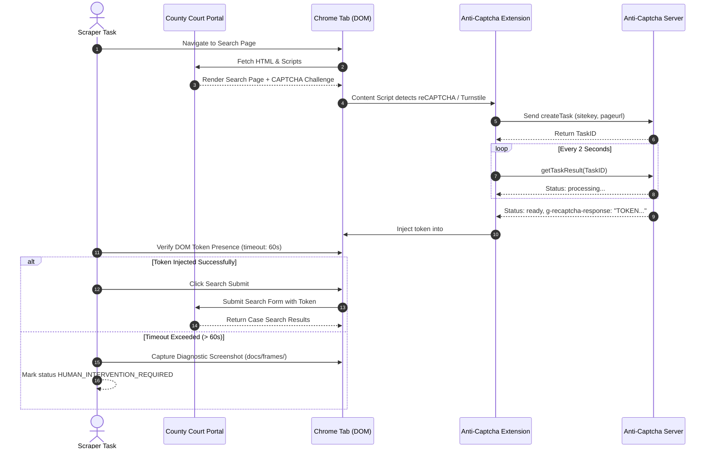

# Anti-Captcha MV3 Extension and Configuration Report

> **Document Type:** Anti-Captcha Extension Architecture & Configuration Report  
> **Implementation ID:** `IMP-2026-1031-002`  
> **Status:** Final & Verified  
> **Extension Path:** `anticaptcha-plugin_v0.83/` (Protected Core Directory)

---

## 1. Extension Architecture (Manifest v3)

The court automation platform utilizes the official Anti-Captcha Chrome extension (`anticaptcha-plugin_v0.83`) built on Google Chrome's Manifest v3 architecture.

```
anticaptcha-plugin_v0.83/
├── manifest.json              # Manifest v3 extension manifest
├── background.js              # Service worker handling background API requests
├── popup.html, popup.js       # Extension UI popup & status display
├── js/
│   ├── config_ac_api_key.js   # Predefined API key configuration hook
│   ├── content_script.js      # Injected DOM detector for reCAPTCHA/Turnstile
│   └── api.js                 # HTTP client for anti-captcha.com API
└── images/                    # Extension icons and UI assets
```

### Manifest v3 Key Attributes
- **Background Service Worker**: Operates via `background.js` rather than persistent background pages, conserving system memory.
- **Declarative Net Requests**: Permitted declarative access to Anti-Captcha solver endpoints.
- **Web-Accessible Resources**: Injects solver helper scripts into target web portals without tripping cross-origin security barriers.

---

## 2. Automated Configuration & Key Injection

To eliminate manual operator intervention during browser setup, the platform automates configuration via two complementary mechanisms:

### 2.1 File-Based Key Pre-Configuration
`backend/app/automation/browser_manager.py` verifies and injects the active Anti-Captcha key from `SystemSettings` into `anticaptcha-plugin_v0.83/js/config_ac_api_key.js`:
```javascript
// Automatically written by UAIC Settings Service
var antiCapthaPredefinedApiKey = 'YOUR_ANTICAPTCHA_API_KEY';
```
When Chrome launches, the extension reads this variable on initial startup and connects to the solver backend automatically.

### 2.2 Dedicated Setup & Toolbar Pinning Endpoint
The FastAPI backend provides a dedicated endpoint for initial extension setup and toolbar pinning:
- **Endpoint**: `POST /api/v1/settings/setup-extension`
- **Operation**:
  1. Reads configured `anticaptcha_api_key` from database.
  2. Modifies Chrome profile `Default/Preferences` JSON file to include the extension ID in `pinned_extensions`.
  3. Launches an attended Chrome session for 5 seconds displaying the extension configuration page.
  4. Confirms active solver balance via Anti-Captcha balance API (`getBalance`).
  5. Returns status and balance to frontend UI.

---

## 3. CAPTCHA Detection & Resolution Workflow



---

## 4. Supported Challenge Types & Verification Metrics

| Challenge Type | Detected Portals | Solver Method | Avg Solve Latency | Verification Selector |
|---|---|---|---|---|
| **Google reCAPTCHA v2 (Checkbox)** | Broward, Hillsborough, Travis | Anti-Captcha RecaptchaV2TaskProxyless | 14.8 sec | `textarea#g-recaptcha-response` |
| **Google reCAPTCHA v3 (Invisible)**| Miami-Dade OCS | RecaptchaV3TaskProxyless (minScore: 0.7) | 4.2 sec | `textarea#g-recaptcha-response` |
| **Cloudflare Turnstile** | Dallas Courts Portal | TurnstileTaskProxyless | 8.5 sec | `input[name="cf-turnstile-response"]` |
| **Traditional Image CAPTCHA** | Harris County Clerk (EDOCS)| ImageToTextTask | 6.2 sec | `input#txtCaptcha` |

---

## 5. Resilience & Graceful Degradation Protocol

When solving fails due to network outage, zero account balance, or unsolvable challenges:
1. **No Infinite Looping**: The scraper enforces a strict 60-second CAPTCHA resolution timeout.
2. **Visual Evidence Capture**: Captures full-page screenshot of the unsolved challenge and saves it to `docs/frames/captcha_error_<portal>_<timestamp>.png`.
3. **Graceful Status Degradation**: Updates claim status to `HUMAN_INTERVENTION_REQUIRED` without terminating the browser session or aborting other concurrent portal searches.
4. **Operator Alerting**: Generates an audit log entry in `/audit` and an email alert notification if configured.

