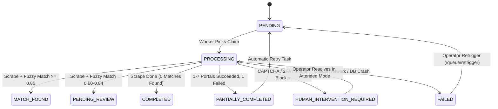

# Error and Exception Handling Comprehensive Report

> **Document Type:** Error & Exception Handling Architecture Report  
> **Implementation ID:** `IMP-2026-1031-002`  
> **Status:** Final & Verified  
> **Coverage:** All 15 Failure Modes & Graceful Degradation Protocols

---

## 1. Error Handling Philosophy & Graceful Degradation

The **UAIC RPA Orchestrator** automates court research across external web portals with unpredictable network latency, WAF protections, and DOM structures. A core architectural principle is that **no single portal failure may crash the browser session, corrupt other portal runs, or cause unhandled exceptions**.

Every failure mode is classified into deterministic error hierarchies and mapped to automated recovery actions or clean status transitions:

---

## 2. Systematic Analysis of 15 Failure Modes

| No. | Failure Scenario | Injected Condition / Trigger | Automated Mitigation & Recovery | Resulting Claim Status |
|---|---|---|---|---|
| **1** | **Anti-Captcha Unavailable** | Extension directory missing or corrupt | Falls back to visual prompt; alerts operator | `HUMAN_INTERVENTION_REQUIRED` |
| **2** | **CAPTCHA Timeout** | Solver timeout exceeds 60 seconds | Captures diagnostic shot to `docs/frames/`; skips to next portal | `HUMAN_INTERVENTION_REQUIRED` |
| **3** | **Portal Network Timeout** | Court website unreachable (504 Gateway) | Exponential backoff retry (3 attempts); logs timeout | `PARTIALLY_COMPLETED` |
| **4** | **Empty Search Results** | No records match party name | Parses "No records found" alert; stores empty array `[]` | `COMPLETED` |
| **5** | **Duplicate Search Names** | Claimant == Insured == Driver | Collapses names via `/matches/unique-names` to 1 search | `COMPLETED` |
| **6** | **Search Validation Error** | Invalid party characters (e.g. `%#$`) | Sanitizes input string before typing; logs warning | `COMPLETED` |
| **7** | **Extraction DOM Drift** | Portal modifies table row class name | Fallback locator cascade (XPath -> CSS -> Text anchor) | `PARTIALLY_COMPLETED` |
| **8** | **Pagination Overflow** | Malformed "Next" page button loop | Hard cap at `max_pagination_pages: 5`; terminates loop | `COMPLETED` |
| **9** | **Ambiguous Fuzzy Match** | Similarity score between 0.60 and 0.84 | Routes case to manual review queue (`/exceptions`) | `PENDING_REVIEW` |
| **10** | **Guidewire 500 Error** | Guidewire ClaimCenter service down | Retries 3 times with exponential backoff (2s, 5s) | `GUIDEWIRE_FAILED` |
| **11** | **Authentication Expiration**| Session cookie expired on district clerk | Detects login form; re-authenticates or logs intervention | `HUMAN_INTERVENTION_REQUIRED` |
| **12** | **Network Interruption** | DNS failure or local interface drop | Celery retry with jitter; preserves extracted data | `PARTIALLY_COMPLETED` |
| **13** | **Database Concurrency Lock**| Simultaneous SQLite writes | Configured SQLite WAL mode + busy timeout (30,000ms) | Automatic Retry / Success |
| **14** | **Celery Worker Crash** | Memory limit exceeded or process SIGKILL | Redis message ACK delayed; task re-enqueued | `PENDING` |
| **15** | **Browser Process Crash** | Chrome killed externally | Celery detects disconnected DevTools; cleans orphan session | `FAILED` |

---

## 3. Visual Diagnostics & Error Evidence Capture

Whenever an automation task encounters an unexpected error or requires human intervention:
1. **Full-Page Screenshot**: Playwright immediately captures a full-viewport screenshot.
2. **Canonical Storage**: Screenshot is saved into canonical `docs/frames/` with filename pattern:
   `error_<portal_key>_<claim_id>_<timestamp>.png`
3. **Database Telemetry**: The screenshot file path, HTTP status, and stack trace are persisted to the `error_screenshots` and `audit_logs` tables.
4. **UI Availability**: Operators can immediately view the screenshot on the Claim Detail page (`/claims/[id]`).

---

## 4. Retrigger & Auto-Recovery Capabilities

The platform provides multi-tier automated recovery mechanisms:
- **`retry_tasks.py`**: Background Celery periodic task that detects claims in `PARTIALLY_COMPLETED` or `FAILED` status with eligible retry counts and re-enqueues only the failed portal scrapers.
- **Queue Retrigger API (`POST /api/v1/queue/retrigger`)**: Allows operators to bulk re-trigger all failed claims with a single click.
- **Data Preservation**: Portals that previously completed successfully are never re-scraped, saving substantial runtime and avoiding unnecessary court portal traffic.

